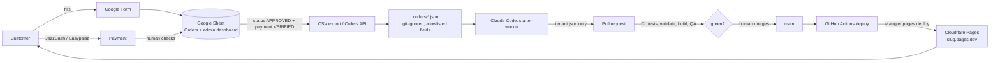

<!-- Websites Factory | abdullah fayyaz -->
# Architecture

## Goal
Sell a Rs. 972 one-page "Starter" website with **no per-site cost** and **no paid AI API**: Claude Code (on Abi's own
plan) writes structured data, free tools do everything else.

## End-to-end flow


| Step | Who/what | Cost |
| --- | --- | --- |
| Intake | Google Form -> Apps Script trigger writes a row, assigns `WEB-xxxx`, flags duplicate TIDs, e-mails customer + admin | free |
| Payment check | **Human** compares the TID with the JazzCash/Easypaisa message, sets `payment_status = VERIFIED` and `status = APPROVED` | free |
| Build | Claude Code interactive/scheduled session (about twice a day) | included in plan |
| Render | `engine/` (Node, zero dependencies) | free |
| Gate | CI: unit tests, schema/semantic validation, QA of the *built* output | free (GitHub Actions) |
| Deploy | `wrangler pages deploy` of a prebuilt folder, one Pages project per customer | free (Cloudflare Pages) |

## Key design decision: AI writes JSON, never HTML
Letting a model write raw HTML/CSS for every customer is expensive to review, inconsistent, and unsafe (customer text can
steer it). Instead:

1. `schema/tenant.schema.json` is the **contract**: fixed fields, length limits, https-only URLs, no unknown keys.
2. The agent fills it (`tenants/<slug>/tenant.json`). It cannot produce markup, scripts or arbitrary CSS.
3. `engine/render.mjs` is a pure function `tenant.json -> files`. Every string is HTML-escaped by the `html` tagged
   template. Themes are CSS variables resolved so every theme x colour meets WCAG AA contrast (tested exhaustively).
4. `engine/qa.mjs` inspects the **built** pages (one `<h1>`, alt text, no scripts/inline styles/http links, no placeholder
   text, CSP hash matches the CSS, WhatsApp link valid ...). A failing QA blocks the merge and the deploy.

Result: consistent quality, review in seconds (a small JSON diff), and prompt-injection from order text has nowhere to go.

## Repository layout
```
engine/      render, themes, styles, i18n, validate, qa            (pure functions, unit-tested)
schema/      tenant.schema.json                                     (the contract)
scripts/     build, validate, qa, preview, changed-tenants, orders-import (+ lib/)
tenants/     <slug>/tenant.json + assets/                           (one folder per customer; "_" = sample)
google/      setup-form.gs (+ test harness)                         (Google Form + Sheet + Apps Script)
tests/       node:test suites
docs/        this folder
.claude/     starter-worker agent, /process-orders command
.github/     ci.yml (PRs), deploy.yml (main -> Cloudflare)
```

## Hosting model
One **Cloudflare Pages project per customer** via Direct Upload from GitHub Actions
(`cloudflare/wrangler-action@v3`; `wrangler pages project create` then `wrangler pages deploy dist/<slug>`).
Address: `https://<slug>.pages.dev`. If the name is already taken by someone else Cloudflare adds a suffix; the deploy
summary prints the real production address, which a human records in the sheet (`live_url`).

Limits to respect (Cloudflare Pages docs, checked 2026-11): 100 projects per account, 500 builds/month (we do not use
Cloudflare builds), 20,000 files per site, 25 MiB per file. **The 100-project cap is the scaling ceiling of this design**;
see ROADMAP Phase 4 for the way out.

## Data & privacy boundaries
| Data | Lives in | Never in |
| --- | --- | --- |
| Payment details, private e-mail, TID, consent | Google Sheet only | repo, tenant.json, PRs, logs |
| Public business info (name, services, public phone) | `tenants/<slug>/tenant.json` | - |
| Secrets (`CLOUDFLARE_API_TOKEN`, account id) | GitHub repository secrets | repo, chat, CLAUDE.md |

Customer data flows to the repo only through `scripts/orders-import.mjs`, which copies an explicit allowlist of columns
(`scripts/lib/orders.mjs`) into the git-ignored `.orders/` folder. Tests fail if a private column ever enters the allowlist.

## Order statuses
`NEW -> PAYMENT_REVIEW -> APPROVED -> BUILDING -> QA_REQUIRED -> DEPLOYED -> DELIVERED`, with `NEEDS_INFO`, `REVISION`,
`REJECTED`, `ON_HOLD` as side states. Only `payment_status = VERIFIED` plus `APPROVED`/`REVISION` enters the build queue.
