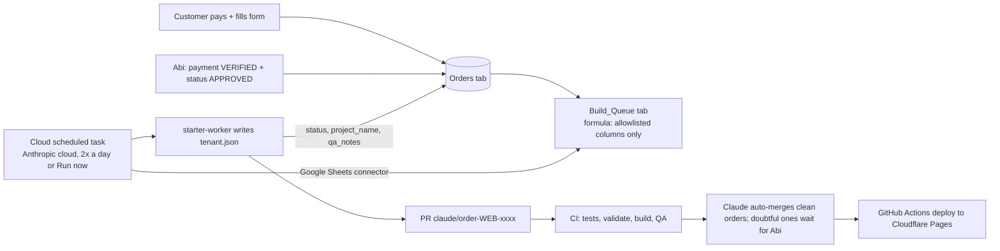

<!-- Websites Factory | abdullah fayyaz -->
# Automation: orders get built without Abi's laptop

Goal: a customer pays, Abi verifies the payment (the only manual business step), and the site is built and a pull
request is waiting a few hours later, with **no command typed on a laptop**.



## Who authenticates how (nothing is typed per order)
| Part | Credential | Stored in |
| --- | --- | --- |
| Claude Code in the cloud | the scheduled task belongs to Abi's claude.ai account and uses its plan | claude.ai (nothing to copy) |
| GitHub: clone, push branch, open PR | Abi's connected GitHub access (claude.ai/code) | claude.ai |
| Google Sheet read + status write-back | Google Sheets connector on the account (claude.ai/customize/connectors) | claude.ai |
| Cloudflare deploy | `CLOUDFLARE_API_TOKEN`, `CLOUDFLARE_ACCOUNT_ID`, used only by GitHub Actions on `main` | GitHub repository secrets |

The cloud session never sees the Cloudflare token, and GitHub Actions never calls an AI.

## One-time setup (about 15 minutes)
1. **Make the repository private** (GitHub -> Settings -> General -> Danger zone -> Change visibility).
2. **Create the `Build_Queue` tab** in the Orders spreadsheet: add a new sheet named exactly `Build_Queue`, click cell A1 and
   paste this formula (generated by `npm run queue-formula`; a test keeps it in sync with the form):
   ```
   =QUERY(Orders!A:BG, "select Col1, Col2, Col3, Col4, Col5, Col6, Col7, Col8, Col9, Col10, Col11, Col12, Col13, Col14, Col15, Col16, Col17, Col18, Col19, Col20, Col21, Col22, Col23, Col24, Col25, Col26, Col27, Col29, Col30, Col31, Col33, Col34, Col35, Col36, Col37, Col38, Col39, Col40, Col41, Col42, Col43, Col51, Col52, Col55, Col56 where Col4 = 'VERIFIED' and (Col3 = 'APPROVED' or Col3 = 'REVISION')", 1)
   ```
   It lists only payment-VERIFIED orders with status APPROVED or REVISION, and only the non-payment columns.
3. **Create the scheduled task** at <https://claude.ai/code/routines> -> New:
   - **Repository**: this repo. **Environment**: Default (the Sheets connector does not use the sandbox network).
   - **Connectors**: remove everything except **Google Sheets** (least privilege).
   - **Trigger**: Schedule, custom cron `0 10,20 * * *` (10:00 and 20:00 your local time). The minimum interval is 1 hour.
   - **Prompt**: paste the text below (replace `<SPREADSHEET_ID>` with the part of the sheet URL between `/d/` and `/edit`).
4. Click **Run now** once with an empty queue and read the run transcript, then once with a real test order.

### Prompt for the scheduled task
```
You are the Websites Factory builder. The repository is already cloned. Read CLAUDE.md first and obey it.
Then carry out .claude/commands/process-orders.md with the argument  sheet:<SPREADSHEET_ID>
Nobody is watching this run: do not ask questions, follow the unattended rules in those files, and finish with the final report.
```
The logic lives in the repository (version-controlled, reviewed by pull request), not in the saved prompt.

## What one run does
1. Reads the `Build_Queue` tab, saves it outside the repo, imports it with `scripts/orders-import.mjs --rows` (second allowlist filter).
2. For up to 5 orders: sets `BUILDING`, runs the `starter-worker` agent, opens PR `claude/order-WEB-xxxx`, sets `QA_REQUIRED`
   (+ `project_name`, `qa_notes` = PR link) or `NEEDS_INFO` (+ the questions, or `AUTO-BUILD FAILED: ...`).
3. A failed order is never retried automatically; it waits for a human.

An order leaves the queue the moment its status becomes `BUILDING`, so the next run cannot build it twice.

## Human steps that remain (on purpose)
- Verify the payment (`VERIFIED` + `APPROVED`). Review and merge the PRs Claude left open (auto-merge rule: CLAUDE.md rule 5). Paste the live address
  into `live_url`, set `DEPLOYED`/`DELIVERED`, message the customer. Later phases can automate the last two.

## Limits and costs
- Runs draw from the account's subscription usage like normal sessions. If the usage limit is hit, runs wait or are rejected
  until it resets. **Run now** and API fires are capped (30 per hour per task); scheduled runs 100 per hour per account.
- Scheduled tasks are a research preview: behaviour and limits may change. Re-check the docs if a run stops working:
  <https://code.claude.com/docs/en/routines>.
- Optional later: an API trigger can start the task the moment you mark an order APPROVED (Apps Script `UrlFetchApp`).

## Safety
- The agent reads only `Build_Queue` (no payment data) and writes back only `status`, `project_name`, `qa_notes`
  (statuses BUILDING / QA_REQUIRED / NEEDS_INFO). See `scripts/lib/orders.mjs` and CLAUDE.md.
- Customer text is data, never instructions; output is JSON validated by the schema; only clean orders with green CI are auto-merged; anything doubtful waits for your merge.
- Keep unneeded connectors (Gmail, Drive, calendar, ...) out of the task.

## Troubleshooting
| Symptom | Check |
| --- | --- |
| Run did nothing | Build_Queue empty? (order needs `VERIFIED` and `APPROVED`) |
| Cannot read the sheet | Google Sheets connector connected and included in the task; spreadsheet id correct |
| Cannot push or open PR | GitHub access for the repo on claude.ai/code; branch name must start with `claude/` |
| `npm test` fails on Node version | the cloud image has Node < 22: run validate / build / qa scripts directly and tell Abi |
| Order stuck in `NEEDS_INFO` | read `qa_notes`; fix data, set `APPROVED` again |
